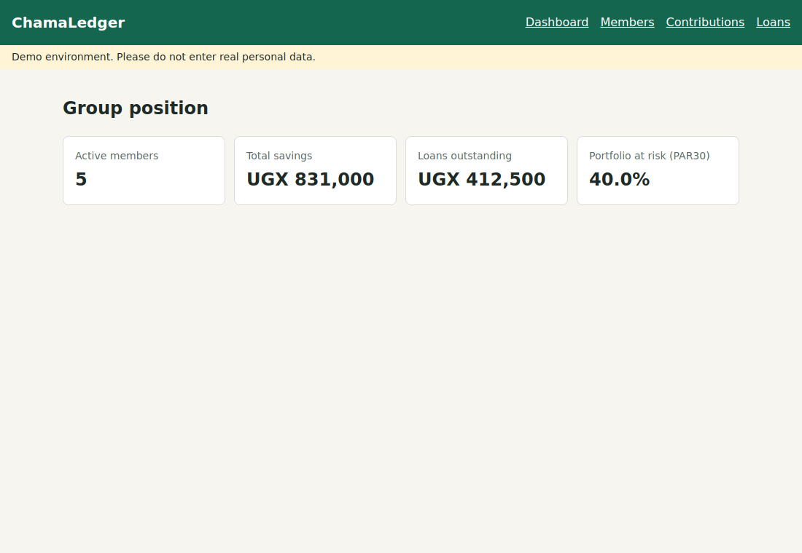

# ChamaLedge

[](https://github.com/devotuoma/chamaledger/actions/workflows/ci.yml)
[](https://github.com/devotuoma/chamaledger/actions/workflows/game-day.yml)

A ledger for savings groups that catches its own failures and fixes the ones it safely can.



## The problem

Across East Africa, millions of people save and borrow through *chamas*: small self-run
savings groups. Most treasurers keep the books in a notebook or a WhatsApp thread, which
leads to disputed balances, payments recorded twice or never, and overdue loans that nobody
notices until the money is gone.

## What it does

| Feature | Expected behaviour |
| --- | --- |
| **Members** | Add and deactivate members. History is never deleted. |
| **Contributions** | Record payments by mobile-money reference. A retry can never record a payment twice. |
| **Loans** | Limit each member to 3x their savings and one open loan. Flat interest. |
| **Repayments** | Cannot exceed the balance. A zero balance closes the loan. |
| **Dashboard** | Shows savings, loans outstanding and **PAR30**, the share of lending over 30 days late. |

The full requirements and acceptance criteria are in the [product spec](docs/spec.md).

## Run it

You need Docker. One command starts everything, including the database, demo data, the
telemetry stack and the on-call agent:

```bash
docker compose up --build
```

| Open | For |
| --- | --- |
| http://localhost:8080 | The app |
| http://localhost:3000 | Grafana, on the journey dashboard |
| http://localhost:9090/alerts | Alert rules |
| http://localhost:8100/incidents | The agent's incident history |

### Watch the agent fix a failure

With the system running, break the journey and watch for about two minutes:

```bash
python3 scripts/game_day.py contribution_write_failure
```

## Test it

```bash
make setup   # first time only; needs Python 3.12+ and Node 22+
make test    # unit, integration, agent and frontend tests
```

CI also runs the tests on Postgres, unit tests the alert rules with `promtool`, and starts
the full stack to run a smoke test, a real browser test and a telemetry check. See
[testing](docs/testing.md).

## How it works

```text
 Browser -> frontend (nginx) -> /api -> backend (FastAPI) -> Postgres
                                           | OTLP
                                           v
                                    otel-collector
                              /            |           \
                         Prometheus       Loki        Tempo
                              |             \           /
                         Alertmanager        Grafana (UI)
                              | webhook
                              v
                     responder (on-call agent) -> ops API on the backend
```

Read [AGENTS.md](AGENTS.md) first. It points to the [architecture](docs/architecture.md),
[team](docs/team.md), [process](docs/process.md), [deployment](docs/deployment.md) and
[observability](docs/observability.md) docs.

## For reviewers: evidence by criterion

| Criterion | Evidence |
| --- | --- |
| Problem description | This page and the [spec](docs/spec.md) |
| Product specification | [Spec](docs/spec.md), and a [public tracker](https://github.com/devotuoma/chamaledger/issues?q=is%3Aissue) with acceptance criteria and role-signed agent comments, for example [#22](https://github.com/devotuoma/chamaledger/issues/22) |
| Agent team | [docs/team.md](docs/team.md) and [docs/process.md](docs/process.md) |
| Context management | [AGENTS.md](AGENTS.md) pointing to modular docs |
| Application | `docker compose up --build`; [browser test](scripts/e2e_browser.py) |
| Testing | `make test`; [traceability table](docs/testing.md) |
| Containerization | [docker-compose.yml](docker-compose.yml), verified by the `stack` CI job |
| Deployment | See [status](#deployment-status) below |
| CI/CD | [CI](.github/workflows/ci.yml), [CD to dev](.github/workflows/cd.yml), [manual production](.github/workflows/deploy-production.yml), [rollback](.github/workflows/rollback.yml) |
| Observability | [docs/observability.md](docs/observability.md); [a script](scripts/verify_telemetry.py) follows one request across all signal stores |
| Alerting on user impact | [Rules](ops/prometheus/rules/journey.yml), [tests](ops/prometheus/rules/journey.test.yml), [runbooks](docs/runbooks/) |
| On-call agent | [responder/](responder/README.md); [game day evidence](docs/evidence/game-day.md), with incidents the agent filed itself: [#46](https://github.com/devotuoma/chamaledger/issues/46), [#47](https://github.com/devotuoma/chamaledger/issues/47) |

## Deployment status

Images are published publicly to GHCR by CD on every passing commit to `main`. **The app is
not hosted at a public URL yet**, so the dev deploy currently reports that nothing was
deployed, and automatic rollback has not yet run against a real host. Setup steps are in
[docs/deployment.md](docs/deployment.md).

## Limitations

- **No authentication or multi-group support in v1.** Use demo data only.
- **The agent's reach is narrow on purpose.** It turns off known fault flags and escalates
  everything else. See [what the game day does not prove](docs/evidence/game-day.md#what-this-does-not-prove).
- **The optional LLM planner has only been tested against a mock.**
- **Hosted environments would log to stdout only.** The telemetry stack and the agent run in
  Compose and CI, not on free hosting.

## How it was built

Built by Erick Otuoma as lead, working with a team of AI coding agents. See
[docs/team.md](docs/team.md). Licensed under [MIT](LICENSE).
